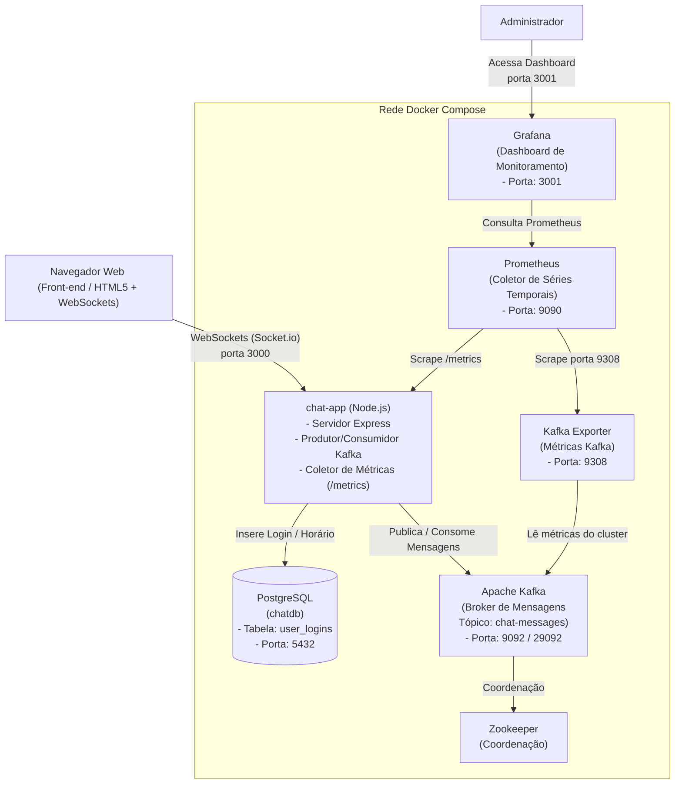

# Hiper Chat Local

## Arquitetura do Sistema



## Como Executar

1. Pare e remova os containers antigos:
   ```bash
   docker compose down
   ```
2. Suba a nova arquitetura completa:
   ```bash
   docker compose up --build -d
   ```

## URLs e Acessos

- **Chat Web:** `http://localhost:3000`
- **API de Logins Registrados (PostgreSQL):** `http://localhost:3000/api/logins`
- **Grafana Dashboard:** `http://localhost:3001` (Usuário: `admin` | Senha: `admin`)
- **Prometheus:** `http://localhost:9090`
- **PostgreSQL:** `localhost:5432` (Database: `chatdb` | Usuário: `chatuser` | Senha: `chatpassword`)

## Matriz RACI da Equipe

| Atividade | Cristiano | Gabrieli | Nathan | Patric |
|:---:|:---:|:---:|:---:|:---:|
| Desenvolvimento da aplicação | A/R | I | I | I |
| Configuração do Docker | C | I | A/R | C |
| Implementação do Terraform (IaC) | I | C | A/R | C |
| Deploy na nuvem | C | I | A/R | C |
| Implementação de mensageria ou serverless | R | I | C | A |
| Configuração de logs e métricas | C | I | C | A/R |
| Criação do dashboard | I | C | C | A/R |
| Testes de funcionamento e integração | R | A | C | C |
| Testes de disponibilidade e escalabilidade | C | I | A/R | R |
| README e documentação técnica | C | A/R | C | C |
| Registro de logs, eventos e evidências | I | A | C | R |
| Preparação dos slides | C | A/R | C | C |
| Apresentação e revisão final | R | A | R | R |